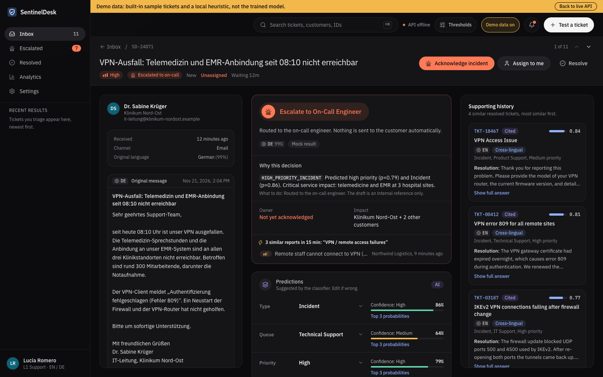

# SentinelDesk

> Multilingual incident triage, escalation gate and grounded reply drafting for IT support (English and German).

## What it does

SentinelDesk reads an incoming support ticket in English or German, predicts its type, queue and priority, and finds the most similar resolved tickets in either language.
A rule-based safety gate decides whether the ticket goes to the on-call engineer, to human review, or gets an AI reply draft. Every decision carries a reason code with the numbers behind it.
Drafts come from Gemini, may only state facts from cited past resolutions, and are never sent without a person approving them in the console.



*The ticket workspace for a German VPN outage. The gate routes it to on-call (`HIGH_PRIORITY_INCIDENT`, P(high)=0.79, P(Incident)=0.86) and retrieves English VPN resolutions as evidence. Screenshot taken in the console's "Demo data" mode.*

## Architecture

```
            ┌──────────────── web/ (Team C) ────────────────┐
            │ Vite + React console  ── POST /triage ──┐     │
            └─────────────────────────────────────────┼─────┘
                                                      ▼
┌──────────────────────────── api/ (Team A) ───────────────────────────────┐
│ 1 build_text(subject, body)              shared/text.py                  │
│ 2 mask_pii(text)                          agent/pii.py        (B1)       │
│ 3 detect_language(masked)                 agent/lang.py       (B1)       │
│ 4 TriageClassifier.predict(masked)        ml/predict.py       (A)        │
│ 5 AgentPipeline.run(masked, lang, preds)  agent/pipeline.py   (B2)       │
│     ├─ Retriever.embed + search (top-5)   agent/retrieve.py   (B1)       │
│     ├─ BurstDetector.observe              agent/burst.py      (B1)       │
│     ├─ pre_draft_gate                     agent/gate.py       (B2)       │
│     ├─ generate_draft → Gemini API        agent/draft.py      (B2)       │
│     ├─ validate_citations                 agent/citations.py  (B2)       │
│     └─ finalize_escalation                agent/gate.py       (B2)       │
│ 6 assemble response + latency_ms          api/service.py      (A)        │
└──────────────────────────────────────────────────────────────────────────┘
   artifacts/clf.joblib (A)     artifacts/kb.faiss + kb_meta.parquet (B1)
   eval/run_eval.py → eval/results/metrics.{json,md} → GET /metrics → console KPI strip
```

| Component | Choice |
|---|---|
| Classifier | TF-IDF (word 1–2 grams + char 3–5 grams) with one logistic regression per head (type, queue, priority) |
| Embeddings | `sentence-transformers/paraphrase-multilingual-MiniLM-L12-v2` (384-dim), shared space for English and German |
| Vector store | FAISS `IndexFlatIP` (exact cosine) over the knowledge-base split |
| Language detection | `lingua-language-detector` with a function-word tie-break for English-heavy German tickets |
| LLM | Google Gemini (`gemini-3.5-flash-lite` by default, set by `SENTINEL_LLM_MODEL`), structured JSON output |
| API | FastAPI on port 8000. HTTP contract: [docs/contract.md](docs/contract.md) |
| Console | Vite + React + TypeScript + Tailwind on port 5173 |

## Setup

Requires Python 3.14 and Node.js 20.19+ or 22.12+.

```bash
python -m venv .venv
# Windows: .venv\Scripts\activate    macOS/Linux: source .venv/bin/activate
pip install -r requirements.txt
cp .env.example .env              # then set GEMINI_API_KEY

python -m ml.make_split           # 80/20 split, seed 42; prints the split fingerprint (expect 5a2ede85f9fb)
python -m ml.train                # writes artifacts/clf.joblib
python -m agent.build_index       # writes artifacts/kb.faiss and artifacts/kb_meta.parquet (about 100 s on an M1, longer on CPU only)
uvicorn api.main:app --port 8000  # the triage API

cd web && npm install && npm run dev   # the console at http://localhost:5173
```

- `make_split` uses the dataset CSV committed in `data/`. If that file is missing, it downloads it from Hugging Face.
- The console calls `http://localhost:8000` by default. To use another address, put `VITE_API_URL=...` in `web/.env.local`.
- Mock API (no models needed): `SENTINEL_MOCK=1 uvicorn api.main:app --port 8000`.
- Windows: `run.bat` starts the API and the console together (`run.bat mock` for the mock API).
- If the API is unavailable during a presentation, the console's **Demo data** switch in the top bar loads built-in sample tickets and a local heuristic. A banner says so while it is on.
- **macOS:** do not change the import order in `agent/retrieve.py` and `agent/build_index.py` (`sentence_transformers` before `faiss`). The other order crashes with a segfault ([agent/NOTES.md](agent/NOTES.md)).

## Evaluation (20% holdout)

```bash
python -m eval.run_eval --llm-sample 40
```

Results from `eval/results/metrics.md`: run on 2026-11-21, split fingerprint **`5a2ede85f9fb`**, 5,718 test tickets, 0 triage errors. The classifier and gate figures come from `skip_llm=True` runs over the full test set. Grounding comes from a sample of 40 tickets with the LLM switched on.

**Classifier**

| Head | Macro-F1 | Weighted-F1 | Accuracy |
|---|---|---|---|
| Type | 0.878 | 0.869 | 0.870 |
| Queue | 0.594 | 0.605 | 0.606 |
| Priority | 0.630 | 0.642 | 0.642 |

**High-priority incidents** (true priority = high and type = Incident, n = 995)

| Measure | Value |
|---|---|
| Classifier recall (predicted high and Incident) | 0.692 |
| **Escalation recall** (gate status `ESCALATE`) | **0.907** (902 of 995: 880 on-call, 22 human review) |
| Overall escalation rate (all test tickets) | 0.469 |

**Latency** (ms)

| Mode | p50 | p95 |
|---|---|---|
| Without LLM, all 5,718 tickets | 38 | 55 |
| With LLM draft, 40-ticket sample | 940 | 1,416 |

**Grounding** (40-ticket LLM sample)

| Metric | Value |
|---|---|
| Citation validity (no `CITATION_CHECK_FAILED`) | 1.00 (22 of 22 drafts) |
| OK drafts with at least one citation | 1.00 (21 of 21) |
| Reply in the requested language | 1.00 (22 of 22) |
| `INSUFFICIENT_EVIDENCE` rate | 0.025 (1 of 40) |
| `LLM_UNAVAILABLE` rate | 0.45 (18 of 40) |

Language detection agrees with the dataset's `language` label on 88.3% of tickets: 100% on `en` and 72.4% on `de`. Most of the `de` gap is label noise. About 29% of rows labelled `de` are English text ([agent/NOTES.md](agent/NOTES.md)).

Full per-class reports, confusion matrices and reason-code counts: [eval/results/metrics.md](eval/results/metrics.md). The console shows the headline numbers from `GET /metrics`.

## Escalation policy

The gate collects every reason that applies, so a ticket can have several. `ON_CALL` wins over `HUMAN_REVIEW`. A ticket with no reasons gets `AUTO_DRAFT`, and a person still approves the draft before it is sent.

| Reason code | Fires when | Route |
|---|---|---|
| `HIGH_PRIORITY_INCIDENT` | P(priority = high) ≥ 0.20 **and** P(type = Incident) ≥ 0.30 | On-call engineer |
| `PROMPT_INJECTION_SUSPECTED` | The ticket matches an English or German override pattern (drafting is blocked) | Human review |
| `LOW_CLASSIFIER_CONFIDENCE` | Type or priority confidence < 0.50, or queue confidence < 0.25 | Human review |
| `NO_PRECEDENT` | No retrieved resolution with similarity ≥ 0.50 (drafting is blocked) | Human review |
| `UNSUPPORTED_REQUEST` | Asks for a refund, pricing, legal, SLA or security action that no retrieved resolution covers | Human review |
| `LLM_INSUFFICIENT_EVIDENCE` | Gemini returns a holding reply because the evidence is not enough | Human review |
| `CITATION_CHECK_FAILED` | A citation points to an unknown ticket, or a money or percentage figure is not in the cited answers | Human review |
| `LLM_UNAVAILABLE` | The Gemini call fails, times out or is blocked | Human review |

The incident rule uses probabilities instead of the most likely label. This trades extra escalations for recall: a missed outage costs more than a human review. Thresholds were tuned on the validation slice of the knowledge base, never on the test split (`eval/results/threshold_sweep.md`). Full rules and the sensitive-request lexicon: [docs/escalation-policy.md](docs/escalation-policy.md).

## Leakage controls

- **Fixed split.** 80% knowledge base and 20% holdout, seed 42. Every team member's machine checks the same fingerprint, `5a2ede85f9fb` (SHA-256 of the test ticket IDs), and `metrics.json` records it.
- **Test answers never touch disk.** The holdout's `answer` and `tags` columns are not written. Test inputs (`ticket_id`, `subject`, `body`) and labels sit in separate files.
- **One reader for test labels.** Only `eval/run_eval.py` opens `data/test_labels.parquet`, and only after all predictions are saved.
- **Knowledge base only.** The classifier, the FAISS index and the threshold tuning use knowledge-base rows only. `build_index` asserts that no indexed ticket ID appears in the test inputs.
- **Tuning on validation.** Classifier settings and gate thresholds were tuned on a 10% validation slice of the knowledge base, with each ticket's own ID excluded from retrieval.
- **Hand-written demos.** Demo and red-team tickets are written by the team, never copied from test rows. Only 1 test body (0.02%) exactly duplicates a knowledge-base body.

Full rules: [docs/data-and-leakage.md](docs/data-and-leakage.md).

## Bonus features

- **Cross-lingual precedent matching.** English and German tickets share one embedding space, so a German ticket can be answered from English resolutions and the other way round. In a 5-topic check, 13 of 25 hits for German queries were English tickets, on-topic in 4 of 5 topics. The German hospital VPN demo retrieves two English VPN resolutions at 0.81 and 0.80, and the German reply cites them.
- **Burst / major-incident detection.** When at least 3 tickets in 15 minutes reach cosine similarity ≥ 0.65 **and** share a rare term (one found in fewer than 2% of knowledge-base tickets, such as "vpn"), the API flags a possible major incident. The console shows a red banner with the cluster size and label. The rare-term rule keeps false banners at 0% with 10 random tickets in the window (3.3% with 20). Similarity alone gave 21%.
- **PII masking before the LLM.** `agent/pii.py` replaces IBANs, emails, card numbers (Luhn-checked), IPs, phone numbers and account numbers before any text reaches Gemini. It leaves ticket IDs, dates, version numbers and the dataset's own placeholders alone. The console shows how many items of each kind were masked.
- **Human-centred console.** Every suggested statement shows its supporting reference, and statements without one are highlighted. Sending requires an explicit approval step, and the safety check's reasons and thresholds are visible in one click.

## Limitations and next steps

**Limitations**
- **Queue and priority predictions are modest** (macro-F1 0.59 and 0.63). Priority labels are noisy and depend on business context that the text often doesn't state. The gate compensates with probability thresholds, at the cost of a 47% escalation rate.
- **German retrieval is weaker than English.** Some German phrasings embed poorly (for example "doppelt belastet"), so German tickets get `NO_PRECEDENT` more often.
- **`T_SIM` = 0.50 still blocks some real tickets.** On 16 hand-written in-domain tickets, it blocks 12.5% of real IT questions and still catches 93% of off-topic ones. The earlier value, 0.55, blocked 25%.
- **Gemini was unavailable for 45% of the LLM sample** (18 of 40). Those tickets fall back to human review with triage and precedents only.
- **The sensitive-request lexicon can over-match or miss rephrased requests.** The figure check covers money and percentages only, and other claims rely on the human reviewer.
- **The burst detector keeps its window in memory** in a single API process.
- **The console's analytics and recent results cover only the current browser session.** There is no persistence.

**Next steps**
- Fine-tune a multilingual encoder (for example XLM-R), or train the classifier on the retriever embeddings, and compare.
- Add a k-nearest-neighbour vote from the retrieved tickets as a gate signal.
- Try hybrid BM25 + dense retrieval, or `multilingual-e5-base`, for German.
- Calibrate the queue head per class, clean the noisy language and priority labels, and retrain on fit + validation once thresholds are locked.
- Track the cost of false escalations with a real support team.

## Team

| Member | Team | Role |
|---|---|---|
| shaadqrsh | A: ML & Eval | A1: data split, classifier |
| gbuitra (Gustavo) | A: ML & Eval | A2: API service, evaluation, metrics |
| Karanpatel3114 | B: Agent | B1: retrieval, language detection, PII masking, burst detection |
| prithvipoojari | B: Agent | B2: escalation gate, grounded drafting, citations, pipeline |
| miluskapajuelo | C: Frontend | Console UI, README, demo |

Dataset: [Tobi-Bueck/customer-support-tickets](https://huggingface.co/datasets/Tobi-Bueck/customer-support-tickets) (CC-BY-NC-4.0).
